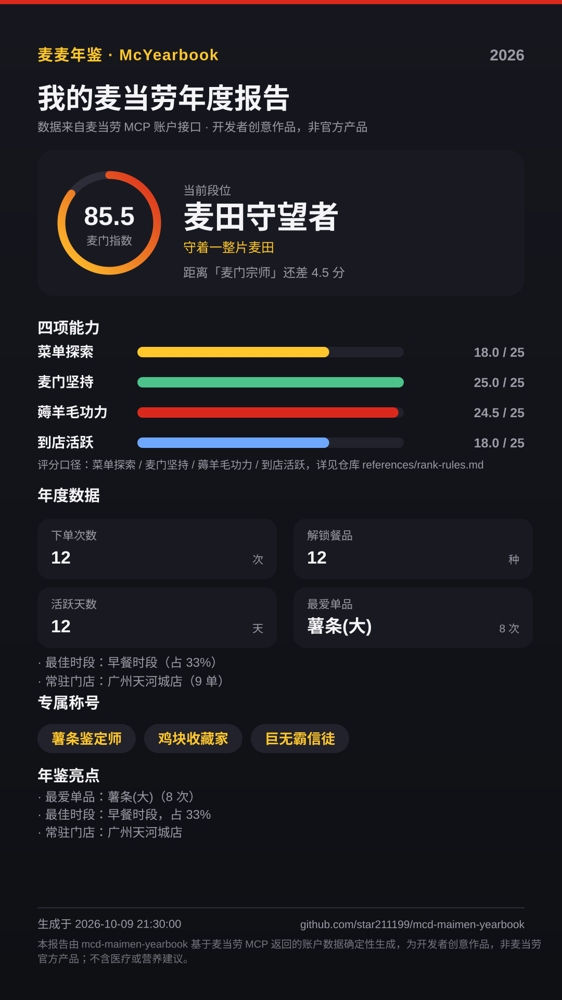
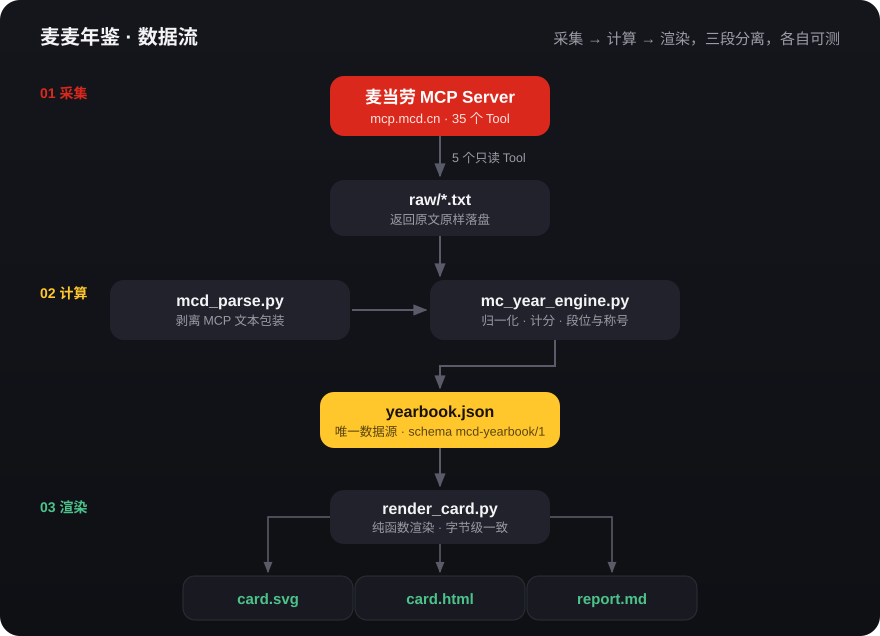
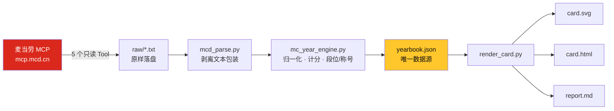

<div align="center">

# 麦麦年鉴 · McYearbook

**把你的麦当劳订单流水，变成一张能晒的年度报告。**

统计最爱单品 · 最佳时段 · 常驻门店 · 券与积分战绩
算出「麦门段位」与专属称号，渲染成一张 1080×1920 的分享卡

<br/>




<sub>↑ 由仓库内的合成夹具渲染（矢量原图 · <a href="examples/demo-report.md">文字版</a>）</sub>

</div>

---

## 这是什么

麦麦年鉴是一个 **WorkBuddy Skill**：接上麦当劳中国官方 MCP Server，
读取你自己的账户数据（历史订单 / 积分 / 卡包 / 抽奖记录），
算出一份**确定性**的年度报告，并渲染成一张竖版分享卡。

它不是"AI 帮你点餐"，也不做营养建议。它只做一件事：

> **把已经发生过的、散落在订单流水里的你，整理成一份值得保存的东西。**

## 30 秒快速开始

```bash
# 1. 拿到 MCP Token（手机号登录 → 控制台 → 激活）
#    https://open.mcd.cn/mcp

# 2. 在 WorkBuddy 里配置连接器，填入 mcp-config.example.json 的内容，
#    把 ${MCD_MCP_TOKEN} 换成你的 Token，保存并「启用」

# 3. 对 WorkBuddy 说一句：
#    「帮我生成我的麦麦年鉴」
```

技能会自动完成「采集 → 计算 → 渲染」，产出：

| 产物 | 说明 |
|---|---|
| `card.svg` / `card.html` | 1080×1920 竖版分享卡，浏览器直接截图保存 |
| `report.md` | 文字版年鉴 |
| `yearbook.json` | 结构化数据（schema `mcd-yearbook/1`），可二次加工 |

## 它长什么样

卡片上固定包含段位、四项能力条、四项年度数据、专属称号与亮点：

| 段位阶梯 | 分数区间 | | 部分称号 |
|---|---|---:|---|
| 麦粒 → 麦芽 → 麦苗 | 0 – 44.9 | | 深夜麦田守护者（夜宵占比 ≥ 40%） |
| 麦穗 → 麦浪 | 45 – 74.9 | | 薯条鉴定师（薯条类占比 ≥ 25%） |
| 麦田守望者 | 75 – 89.9 | | 鸡块收藏家 / 巨无霸信徒 / 咖啡续命师 |
| 麦门宗师 | 90 – 100 | | 门店钉子户 / 聚餐召集人 / 单人食光 |

完整口径（含全部 11 条称号规则、时段边界、关键词表）见
[`references/rank-rules.md`](references/rank-rules.md)。

## 架构

<div align="center">

</div>



**设计原则：数字全部由脚本算，模型只负责采集与讲述。**

## 实际调用了哪些 MCP 能力

麦当劳 MCP 实测开放 **35 个 Tool**（完整清单见 [`references/mcp-tools.md`](references/mcp-tools.md)）。
麦麦年鉴是**只读**技能，只调用其中 5 个：

| Tool | 作用 |
|---|---|
| `now-time-info` | 取服务器时间作为统计基准，不依赖本机时钟 |
| `order-list` | 历史订单 —— 核心数据源 |
| `query-my-account` | 积分账户 |
| `query-my-coupons` | 卡包券 |
| `query-my-prizes` | 抽奖奖品 |

> ⚠️ `create-order`、`cancel-order`、`draw-lottery`、`auto-bind-coupons`、`mall-create-order`、
> `party-order-create` —— **一个都不调用**。
> 你只是想写一份年度总结，不应该因此被下了一单。

详细调用链路与价值说明见 [`MCP_INTEGRATION.md`](MCP_INTEGRATION.md)。

## 为什么这个技能不是"简单包装"

把订单数据丢给通用大模型，让它"总结一下我的麦当劳记录"，会发生三件事：

| | 裸用大模型 | 麦麦年鉴 |
|---|---|---|
| **数值** | 逐单心算，10 单以上开始出现偏差，且每次不一样 | 脚本求和，105 条断言锁死结果 |
| **缺失字段** | 倾向于补一个"看起来合理"的值（编造） | 显式留空并写入 `warnings` |
| **口径稳定性** | 同一份数据两次提问可能给出不同段位 | 同输入 → 同分数 → 同段位，可回归测试 |
| **卡片版式** | 每次自由发挥，无法复现 | 纯函数渲染，字节级一致 |

这套差异不是靠"写得更全的提示词"，而是靠模型在结构上做不到的三件事：

1. **确定性代码**：`mc_year_engine.py` 把评分口径写死成纯函数，
   `--now` 可注入，同一份输入永远得到同一份输出。
2. **真实接口契约**：`references/mcp-tools.md` 是从 MCP Server 实际拉取的 35 个 Tool 快照，
   不是凭记忆写的字段名。
3. **固定工作流**：采集 → 计算 → 渲染三段分离，每段可单独测试。

## 一个真实的接口坑

麦当劳 MCP 的 `tools/call` 返回的 `content[].text` **不是纯 JSON**，实测有三种形态：

| 形态 | 特征 |
|---|---|
| `envelope` | 前面是字段说明，末尾接 `## Original Response` + 一行 JSON |
| `raw-json` | 整段文本本身就是 JSON |
| `markdown` | 完全没有 JSON（`query-my-coupons` 空券包时返回「暂无可用优惠券」） |

直接 `json.loads()` 必然失败。`scripts/mcd_parse.py` 做确定性剥离，并且**只接受含
`success` / `code` / `data` 之一的对象** —— 否则响应被截断时，内层那个配平的
`{"productName": "...", "quantity": 1}` 会被误判为有效数据，最终输出一份
"看起来很正常的假报告"。这条判定有专门的测试守着。

## 测试

零依赖，纯标准库，本地直跑：

```bash
python test/run_all.py
```

```
套件 9 个 · 断言 105 条 · 通过 105 · 失败 0
RESULT: PASS (EXIT 0)
```

覆盖正常 / 空数据 / 500 笔压测 / 截断 JSON / emoji 与 XML 特殊字符 /
负数量与非数字数量 / 提示注入 / 渲染确定性 / CLI 退出码，
夹具全部是手写合成数据（`test/fixture_*.txt`），不含任何真实账户信息。

## 项目结构

```
mcd-maimen-yearbook/
├── SKILL.md                    # 技能定义（触发条件 → 步骤 → 输出格式 → 红线）
├── README.md
├── MCP_INTEGRATION.md          # MCP 接入说明（Server / Tool / 调用流程 / 业务价值）
├── CONTEST_DECLARATION.md      # 参赛声明（官方原文，未作任何修改）
├── mcp-config.example.json     # 脱敏配置，仅环境变量占位符
├── LICENSE
├── scripts/
│   ├── mcd_parse.py            # 剥离 MCP 文本包装 → 结构化数据
│   ├── mc_year_engine.py       # 归一化 · 统计 · 段位与称号
│   └── render_card.py          # 渲染 SVG / HTML / Markdown
├── references/
│   ├── mcp-tools.md            # 35 个 Tool 实测快照 + 5 个只读 Tool 字段契约
│   ├── rank-rules.md           # 评分 / 段位 / 称号完整口径
│   └── data-schema.md          # 中间结构 · 降级策略 · 隐私边界
├── templates/
│   └── report.md               # 文字年鉴模板
├── examples/
│   ├── architecture.svg        # 架构图
│   ├── demo-card.svg           # 示例分享卡（矢量，可导出 PNG）
│   ├── demo-report.md          # 示例文字年鉴
│   └── demo-yearbook.json      # 示例结构化数据
└── test/
    ├── run_all.py              # 验证集入口
    └── fixture_*.txt           # 合成夹具
```

## 隐私

* 账户数据**只在本地处理**，脚本不联网、不外传。
* 卡片与报告**不含**账户 ID 全量、订单号、手机号、地址（`account_id_tail` 只保留后 6 位）。
* 仓库内所有夹具均为合成数据，真实 Token 一律走 `${MCD_MCP_TOKEN}` 占位符。

## FAQ

<details>
<summary><b>我的账号没有订单，能用吗？</b></summary>

能。会生成一份明确标注的「空白年鉴」，而不是报错或编数字。
先去下一单再回来生成即可。
</details>

<details>
<summary><b>为什么段位分数和我预期的不一样？</b></summary>

四项能力的公式、阈值与时段边界全部写在
[`references/rank-rules.md`](references/rank-rules.md) 里，可以自行核对。
想改口径就同时改代码与该文件，然后跑 `python test/run_all.py` 回归。
</details>

<details>
<summary><b>需要联网或者装依赖吗？</b></summary>

不需要装任何依赖，只用 Python 标准库。只有从麦当劳 MCP 取数那一步需要网络，
之后全部离线完成。
</details>

<details>
<summary><b>会帮我下单或领券吗？</b></summary>

不会。麦麦年鉴只调用 5 个只读 Tool，所有写操作接口都被显式排除。
</details>

## Roadmap

- [ ] 支持按季度 / 自定义时间区间出报告
- [ ] 增加「年度对比」卡片（与上一年对比）
- [ ] 支持导出 PNG 与多尺寸社交版式
- [ ] 称号规则可配置化（不改代码即可增删）

## 免责声明

本项目为**麦当劳程序员创意开发大赛参赛作品**，由参赛者独立开发，**非麦当劳官方产品**。
段位与称号为娱乐性创意设定，不构成任何营养、健康或专业建议；
餐品信息、价格与供应状态以麦当劳官方渠道的实时结果为准。

## License

[MIT](LICENSE) © 2026 star211199

<div align="center">
<br/>
如果这个项目让你会心一笑，欢迎点个 ⭐
<br/>
<b>麦门之内，人人都有段位。</b>
</div>
